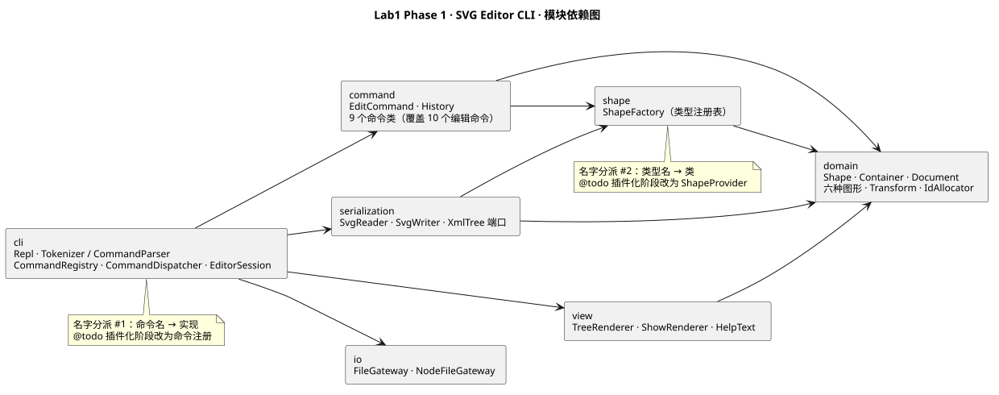
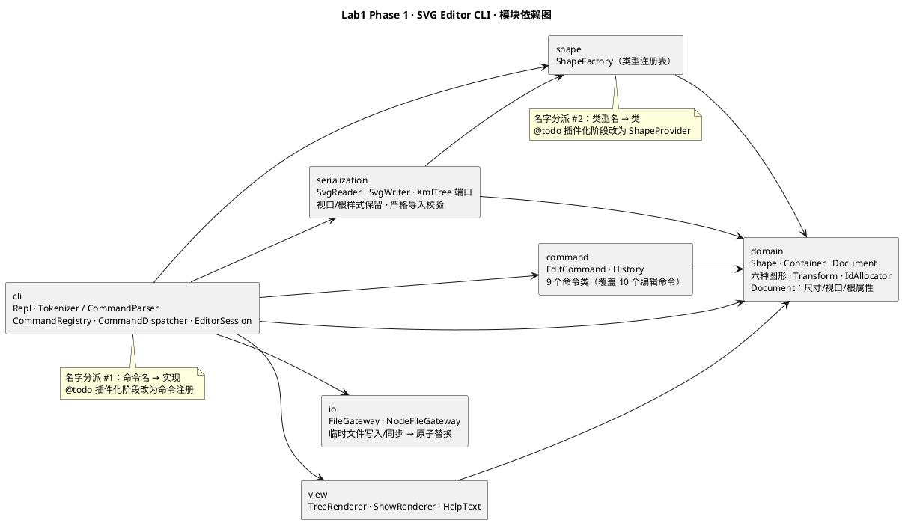

# Lab1 Phase 1 — SVG 编辑器（CLI）

本文件是 Lab1 Phase 1 的完整作业报告，包含架构方案、过程记录、一致性自查与质量保证手段。项目采用 TypeScript 面向对象实现，并使用 Codex 协作开发。

## 提交信息

| 项目 | 内容 |
|---|---|
| **Git 仓库地址** | **[https://github.com/1731067942cjh-hash/GaoJiRuanJian](https://github.com/1731067942cjh-hash/GaoJiRuanJian)** |
| 最终代码 | [final 标签对应的代码与文档](https://github.com/1731067942cjh-hash/GaoJiRuanJian/tree/final) |
| 作业文档 | 工程内的 `doc/README.md`；根目录 `README.md` 是完整提交版，包含本报告全部内容 |
| 截止日期 | **2026 年 10 月 27 日（北京时间，UTC+8）**；按当日结束 **23:59:59** 执行 |
| 最近复查 | 2026 年 10 月 27 日；本次在原有实现上增强 SVG 读写、保存可靠性与文档完整性 |
| 版本依据 | 保留真实分步提交；最终版本由 `final` 标签标识，旧版本分别保存在归档标签中 |

单独提交时，只需提交生成的 **README.md**。其中已包含仓库地址、全部报告章节、架构图链接及 PlantUML 源码，无需再附其他 Markdown 文件。源代码、测试、示例和架构图文件可从仓库取得。

## 安装、运行与操作示例

运行环境：Node.js **22.12+（22.x）、24.x 或 26+**，实测版本 **v26.8.2 / npm 11.19.1**；`.nvmrc` 记录了推荐版本。这与锁定的 Vitest 5 的环境要求一致。

```bash
git clone https://github.com/1731067942cjh-hash/GaoJiRuanJian.git
cd GaoJiRuanJian
git checkout final
npm ci
npm run verify
npm run cli
```

已在本地打开工程时，在工程目录直接执行 `npm run cli` 即可；使用 nvm 可先执行 `nvm install && nvm use`。

```text
svg> init 800 600
canvas 800x600 created
svg> create g scene
g#scene created
svg> create rect node 20 30 160 60 #4a90d9 in scene
rect#node created in g#scene
svg> create text label 40 65 "开始" in scene
text#label created in g#scene
svg> move scene 50 0
g#scene moved by (50,0)
svg> undo
g#scene moved back by (-50,0)
svg> save drawing.svg
saved to drawing.svg (3 elements)
```

保存的 SVG 可直接在浏览器打开。`help` 显示完整语法；`tree` 内联关键几何属性，`show <id>` 显示属性明细。`#` 开头的整行是注释；带空格的文本和路径使用双引号。Ctrl+D 结束输入；非 TTY 模式输出纯结果，便于回放脚本。

| 命令 | 用途 |
|---|---|
| `init [w] [h]`、`read <file.svg>`、`save [file.svg]`、`canvas [w] [h]` | 文档生命周期、文件读写及画布尺寸 |
| `create <type> <id> ... [in <gid>]` | 创建 rect / circle / ellipse / line / text / g 六种内置图形 |
| `delete`、`move`、`scale`、`set` | 对叶子和容器使用统一操作接口 |
| `group`、`ungroup`、`addto`、`front`、`back` | 分组、归属与同级绘制顺序 |
| `tree [id]`、`show <id>`、`help` | 结构、属性和命令说明 |
| `undo`、`redo` | 每条成功编辑命令一个历史单元；IO 成功后按规格锁定历史 |

`set` 只接受公共样式 `fill/stroke/stroke-width`、当前图形自身几何属性及 text 的 `text` 内容属性。`box` 是后续插件阶段目标，本阶段按规格返回未知类型错误。

| 工程命令 | 用途 |
|---|---|
| `npm run cli` | 启动 CLI |
| `npm run typecheck` | 严格 TypeScript 检查 |
| `npm test` | 全部单元与真实 CLI 集成测试 |
| `npm run verify` | 类型检查、测试及 README 同步检查 |
| `npm run diagram` | 用本机 PlantUML 重新生成架构 SVG |
| `npm run submission` | 从 `doc/README.md` 更新完整、可单独提交的根目录 README |
| `npm run submission -- --output <目录>` | 另外导出一份名为 README.md 的提交文件 |


---

## 架构方案

### 1.1 模块划分

```text
src/
├── domain/          纯领域模型：零 IO、零 CLI 依赖
│   ├── Shape.ts            抽象基类（id、父指针、accept、move/scale 契约、公共样式）
│   ├── Container.ts        Composite 基类：children、插入/摘除、递归操作、查找
│   ├── Document.ts         根 <svg>：尺寸/viewBox/根属性、递归查找、全局 id 检查
│   ├── Rect.ts / Circle.ts / Ellipse.ts / Line.ts / TextShape.ts / Group.ts
│   ├── ShapeVisitor.ts     访问者接口（tree / show / SVG 写出共用）
│   ├── Transform.ts        仿射矩阵解析与乘法（read 时烘焙坐标）
│   ├── IdAllocator.ts      外部 SVG 缺 id 时按 <tag><n> 分配
│   ├── NumberFormat.ts     数字解析与无损格式化（保留 JavaScript 数值精度）
│   └── errors/DomainError.ts
├── shape/
│   └── ShapeFactory.ts     类型名/tag → 类（允许的名字分派 #2）
├── command/
│   ├── EditCommand.ts      命令接口：execute / undo
│   ├── History.ts          undo/redo 双栈、io 锁、redo 清空
│   ├── Create/Delete/Move/Scale/Set/Group/Ungroup/AddTo/ReorderCommand.ts
│   ├── GeometrySnapshot.ts 封装子树绝对几何；撤销与数值溢出回滚
│   └── CommandFormat.ts    统一回显文案（容器标签、set 文案）
├── serialization/
│   ├── SvgReader.ts        SVG → Document；补 id、transform 烘焙、警告
│   ├── SvgWriter.ts        Document → SVG（Visitor）
│   ├── XmlTree.ts          XML 端口（与第三方库解耦）
│   ├── XmldomTree.ts       @xmldom/xmldom 适配器
│   └── XmlParseError.ts    解析失败错误
├── view/
│   ├── TreeRenderer.ts     tree 文本（属性内联、层级线、对齐）
│   ├── ShowRenderer.ts     show 属性明细
│   └── HelpText.ts         help 文案
├── io/
│   ├── FileGateway.ts      文件读写端口
│   └── NodeFileGateway.ts  文件适配器：临时文件写入、同步与原子替换
└── cli/
    ├── Tokenizer.ts        引号、转义、行首 # 注释
    ├── CommandParser.ts    命令名 + 参数
    ├── CommandRegistry.ts  命令名 → handler（允许的名字分派 #1）
    ├── CommandDispatcher.ts 统一错误捕获与输出
    ├── EditorSession.ts    封装文档生命周期、路径和 History，成功后才提交状态
    ├── Repl.ts             逐行读入；TTY 才显示 banner/prompt
    ├── main.ts             组合根
    └── commands/           DocumentCommands / EditCommands / ViewCommands 注册类
        └── CommandArguments.ts 参数数量校验类
```

| 模块 | 职责 | 不应该做的事 |
|---|---|---|
| `domain` | 图形树、几何、属性白名单、统一操作语义 | 文件读写、打印、读 stdin、依赖 CLI |
| `shape` | 类型注册与 create 参数 schema；类型名/tag → 类 | 业务规则、IO |
| `command` | 把每个编辑操作封装为对象；维护 undo/redo；失败不落地 | 直接打印、直接读写文件 |
| `serialization` | SVG ↔ 模型；XML 适配；转义与格式 | 依赖 CLI、直接读写磁盘 |
| `view` | tree/show/help 文本呈现 | 修改模型、读写文件 |
| `io` | 读取文本；先完整写入/同步临时文件，再原子替换目标；异常交给 Session 统一报错 | 理解图形语义 |
| `cli` | 分词、解析、分派、REPL、错误文案、组合根 | 持有领域规则（规则在 domain/command） |



> 图源：`doc/architecture.puml`，可用 `npm run diagram` 重新生成。以下同时附源码，单独提交 Markdown 时仍可查看模块与依赖定义。



### 1.2 设计模式的选择与落地

| 模式 | 落地点 | 具体做法 |
|---|---|---|
| **Command（规格强制）** | `src/command/` | `EditCommand` 定义 `execute` / `undo`；每个编辑操作一个类；`History` 作为 Invoker 维护双栈。一条命令 = 一个 undo 单元，`group`/`ungroup` 的多次结构修改在一次 undo 中整体还原。 |
| **Composite** | `Shape` / `Container` / `Group` / `Document` | 容器与叶子共享 id、样式、`moveBy`/`scaleBy`/`transformBy` 契约；容器的移动/缩放递归到全部子孙；`delete` 删除整棵子树；`in`/`group`/`addto` 都是子树操作。 |
| **Factory + Registry** | `src/shape/ShapeFactory.ts` | 一张 “类型名/tag → 类” 表同时服务 `create` 与 `read`；未知类型给出 `unknown shape type: … (is the plugin loaded?)`。 |
| **Visitor** | `view/`、`serialization/SvgWriter.ts` | 每个具体图形实现 `accept(visitor)`；tree、show、SVG 写出是三个访问者，领域模型不 import 任何渲染器。 |
| **Adapter** | `io/NodeFileGateway.ts`、`serialization/XmldomTree.ts` | 把 `node:fs/promises` 与 `@xmldom/xmldom` 藏在小端口后面；测试可替换，库更换只改适配器。 |
| **Facade（轻量）** | `cli/CommandDispatcher.ts`、`EditorSession.ts` | Dispatcher 统一解析与错误输出；Session 封装文档生命周期、路径和历史，调用者不能直接赋值。 |
| **Memento** | `command/GeometrySnapshot.ts` | 私有快照记录完整子树几何；撤销精确还原，move/scale 发生异常或溢出则整体回滚。 |
| **Template Method（基类复用）** | `Shape.loadCommonAttributes` | 公共样式与未知属性的保留逻辑只写一次；子类只处理自己的几何。 |

**允许的两处“按名字分派”（也是唯一两处）：**

| # | 位置 | 映射 | 状态 |
|---|---|---|---|
| 1 | `src/cli/CommandRegistry.ts` | 命令名 → handler | 文件头已标注 `@todo`：插件化阶段改为命令注册 |
| 2 | `src/shape/ShapeFactory.ts` | 类型名 / element tag → 类 | 文件头已标注 `@todo`：插件化阶段替换为 `ShapeProvider` |

其余类型差异全部通过多态（`accept`、`moveBy`、`scaleBy`、`readGeometry` 等）或访问者处理；代码中没有 `switch (tag)`。属性名在各图形类内部按自身语义处理（例如 `Rect` 只认识 `x/y/width/height`），它属于类的内聚行为，不是跨模块的类型分派。

### 1.3 依赖方向规则

| 模块 | 允许依赖 | 理由 |
|---|---|---|
| `domain` | 仅 `domain` | 模型必须可独立测试；禁止 `node:*`、`process`、`console`、外部库 |
| `shape` | `domain` | 工厂只负责“类型名 → 类”，不反向依赖命令 |
| `command` | `domain`, `shape` | 命令操作模型；不打印、不读写文件，结果以字符串返回 |
| `view` | `domain` | 访问者只读模型 |
| `serialization` | `domain`, `shape`；外部 XML 库只允许出现在 `XmldomTree` 适配器 | 读写逻辑与第三方库隔离 |
| `io` | `io` + `node:fs`、`node:path`、`node:crypto` | 文件端口不依赖模型；同目录临时文件需要路径操作与随机唯一文件名 |
| `cli` | 以上全部 + `node:readline` | 组合根与适配层 |

**硬规则：** 不允许反向依赖；不允许模块层级循环（同层接口的 type-only 引用允许）；`domain` 不得 import 任何 UI/IO/序列化代码。
**执行手段：** `test/unit/dependency.test.ts` 静态扫描 `src/**` 的 import，按上表断言；`npm test` 每次运行。当前无违规。

### 1.4 变化点假设

| # | 变化点 | 预判与准备 | 或为何不准备 |
|---|---|---|---|
| 1 | 新增图形类型（`box`、`path`、插件） | 工厂注册表 + `ShapeKind` 元数据；容器已支持任意子树；`read` 与 `create` 共用工厂 | 不在本阶段实现动态插件加载；接缝已在，标注 TODO |
| 2 | `set` 属性白名单/传播语义 | 每个类多态实现 `supportsAttribute`/`getAttribute`/`setAttribute`；新增属性只改一个类 | `box` 的 fill/label 传播属于插件阶段 |
| 3 | SVG 方言（样式、命名空间、transform） | 读写器独立；XML 库藏在 `XmlTree` 后；未建模属性进 `extras` 原样保留 | 不提前支持 CSS/gradient/path 等完整 SVG |
| 4 | 寻址方式（id → 结构路径） | `Document.find` 是模型查找入口，`EditorSession.resolveShape/resolveGroup` 统一 CLI 错误，便于替换 | 规格明确要求 id 寻址，不额外造 Locator 抽象 |
| 5 | 撤销策略（逆操作 → 快照/协同） | 命令接口隔离；`History` 可整体替换；几何用绝对快照避免累积误差 | 不引入事件溯源/CRDT |
| 6 | IO 来源/目标（浏览器、远端） | `FileGateway` 端口 | 本阶段只做本地文件 |
| 7 | 显示格式与本地化 | 渲染器在 `view/`，文案集中 | 不引入 i18n 框架 |
| 8 | 坐标语义（烘焙 vs `transform` 属性） | 解析/变换集中在 `Transform`；模型只存绝对坐标 | 保存不生成 `transform`；若未来要保留结构，改写出与读取策略 |
| 9 | 命令语法扩展（子命令、管道） | `Tokenizer` + `CommandParser` 单点演进 | 不引入通用 parser combinator |
| 10 | 插件化阶段的 `box` 读回 | README/文档已约定 `data-kind="box"`；未注册插件的编辑器降级为普通 `g` | 本阶段不实现插件，故不写 half-plugin |

### 1.5 关键决策与已知限制

| 决策/限制 | 说明 |
|---|---|
| 坐标烘焙 | `move`/`scale` 直接改写子孙坐标；`read` 把 `translate/scale`（无非旋转项的 `matrix`）烘焙进坐标；保存不输出 `transform`。`rotate/skew` 读取时警告并忽略。 |
| `tree` 样式 | 只内联 `fill`（与规格 §5.1、§6.1 示例一致）；`show` 显示 fill/stroke/stroke-width 全量。 |
| `tree` 对齐 | 属性列 = 渲染子树中 `(缩进 + 名称)` 最大长度 + 2。§5.1、§6 示例精确复现（列 19）；§6.1 示例自身列宽不一致（29 与 31），本实现统一为 32，内容正确，差异记录在修订记录。 |
| 文档 IO 与历史 | `init/read/save/canvas 改尺寸` 成功后清空 undo/redo 并上锁；下一次编辑命令解锁；显示类不触碰历史。失败的 IO 不改变状态、不锁历史。 |
| undo/redo 锁文案 | 按规格字面，两个方向都输出 `error: undo not allowed after io command`。 |
| 数字 | `NumberFormat` 使用可往返的最短字符串；保留存储精度（如 `1e-10` 和 `1e30`），`-0` 输出为 `0`；可能显示正常的浮点运算尾差，不通过舍入改变数据。空数字与非有限值拒绝，move/scale 溢出整体回滚。 |
| 未知 SVG 元素 | 警告并跳过（如 `<path>`）；未建模属性保存在 `extras` 并写回。 |
| SVG 根信息 | 保留原始 `viewBox`、根元素 id、公共样式和未建模元数据；根 id 不对 CLI 寻址开放，但参与 id 唯一性检查。`canvas w h` 将视口重置为 `0 0 w h`。 |
| 严格导入 | XML 语法被解析器自动修补也视为失败；显式非法画布尺寸/viewBox 与变换溢出被拒绝，文档、路径和历史保持完整。尺寸接受无单位数字或 px；缺省时才使用 viewBox/800×600。 |
| 可靠保存 | 在同目录写入临时文件并同步、关闭，最后原子替换；替换失败时原文件完整，临时文件清理。保留已有普通文件权限；路径为符号链接时更新其目标。文件权限受操作系统规则约束。 |
| `read` 重复 id | 视为非法输入：`error: duplicate id: <id>`，当前文档不变。 |
| `save` 无路径 | 优先用最后一次 `read` 的路径；若从未 read，则回退到最后一次保存路径；两者都没有时：`error: no file path. use 'save <file.svg>'`（规格外扩展）。 |
| `group` 插入位置 | 先按编辑前的文档遍历顺序排序，保持各目标原有相对顺序；新容器放在排序后第一个目标的位置，并使用其父级。跨父节点的全局顺序采用文档前序遍历。 |
| `ungroup` 根级 | 按规格拒绝；只允许解组嵌套容器。 |
| 非 TTY 输出 | 提示符与 banner 只在 TTY 显示；管道/脚本输出纯净，便于 golden 对比。交互式 PTY 已验证显示 `svg>`。 |
| `scale` 文本 | 缩放 x/y（几何）；不缩放 `font-size`（样式）。`read` 的 transform 烘焙会按比例缩放 `font-size` extra。 |
| `box` | 本阶段不实现；`create box` 只报 `unknown shape type`。 |

---

## 过程记录

第 1–10 项保留已有工程的 2026-10-19 开发记录；第 11–15 项记录 2026-10-26 的规格复查；第 16–18 项记录 2026-10-27 的功能增强、提交文档修正及最终仓库清理。早期测试数量表示当时结果，最终验收结果见后文。

### 1. 规格的 `tree` 列宽自相矛盾

- **发现**：对 `phase_cli_1.md` 的实际字符位置测量发现，§5.1 与 §6 的属性列都是 **19**；§6.1 的普通行是 **29**，而 `text#process-label` 行是 **31**，同一棵树内部不一致。
- **尝试的规则**：一开始计划“每层按最长名字 + 2 对齐”，但无法同时匹配样例。
- **最终选择**：全树统一 `max(前缀 + 名字) + 2`，因为它精确复现 §5.1 和 §6 的列 19；§6.1 变成 32，内容与层级正确。
- **验证**：将 §5.1、§6 的期望输出写进 golden transcript 并逐字比对；§6.1 的差异在修订记录中如实说明，而不是伪造样例。

### 2. Node 原生 TypeScript 的参数属性不可用

- **现象**：探测 `node t.ts` 时，`constructor(public readonly id: string)` 报 `ERR_UNSUPPORTED_TYPESCRIPT_SYNTAX`（strip-only 模式）。
- **判断**：不能把 `node xxx.ts` 作为运行方式；否则所有 OOP 字段封装都要为运行时妥协。
- **处理**：`npm run cli` 使用 **tsx**，类型检查用 `tsc --noEmit`；代码继续使用参数属性与严格类型。
- **验证**：全部 89 个测试通过；`tsx` 与 `tsc` 版本固定并写入锁文件。

### 3. npm 缓存导致的 EPERM

- **现象**：规划阶段在 `workspace-write` 沙箱下执行 `npx tsc` 报 `npm error code EPERM`，默认缓存目录在沙箱外的 `~/.npm`。
- **验证**：将 `npm_config_cache` 指到工作区后，`typescript/tsx/vitest/@types/node` 安装成功。
- **最终**：依赖与锁文件只依赖工作区；文档记录了这一环境差异。后续会话文件策略放开，但仓库本身不依赖该策略。

### 4. 本机 PlantUML/JDK 安装

- **现象**：`brew install plantuml` 报 `Cannot install under Rosetta 2 in ARM default prefix (/opt/homebrew)!`。
- **验证**：`arch -arm64 /opt/homebrew/bin/brew install plantuml` 成功，安装 PlantUML 1.2026.9 与 OpenJDK 27。
- **产物**：`doc/architecture.svg` 由本地 PlantUML 渲染；`npm run diagram` 可复现。另用 PlantUML 生成 PNG 并检查布局，确认模块与箭头可读。

### 5. XML 解析库的选择调整

- **原计划**：`fast-xml-parser`。
- **发现问题**：在需要保留元素顺序、属性顺序、文本内容、未知属性时，`preserveOrder` 结果结构较绕，Reader 代码会混入库细节。
- **处理**：改用 `@xmldom/xmldom`，新增 `XmlTree` 端口与 `XmldomTree` 适配器；领域层和 Reader 不直接依赖 DOM 库。适配器最初用了 `errorHandler` 对象，类型检查报错后改为库 0.9 的 `onError(level, message)` 回调。
- **验证**：`other.svg` 读入 → 写出 → 再读入无警告，7 个元素与结构一致；未知属性 `font-size`/`text-anchor` 原样保留。

### 6. 变换顺序的测试期望错误

- **现象**：为 `translate(10,20) scale(2)` 写的测试期望矩形到 `(22,44)`，实际是 `(12,24)`。
- **验证**：按矩阵 `T × S` 手算并核对 SVG 语义，确认**代码正确、测试期望错误**（先缩放再平移）。
- **处理**：修正测试期望，保留实现；没有为了让测试通过而改实现。

### 7. `tree` 是否显示 `stroke`

- **现象**：第一次运行 §6.1 会话时，`line#arrow1` 的 tree 行带有 `stroke=black`，而规格 §6.1 的示例没有。
- **验证**：对照 §5.1（显示 fill）与 §6.1（未显示 stroke），确定 tree 只内联 fill；`show` 仍输出全部样式。
- **处理**：`TreeRenderer` 改为只显示 fill；更新 golden transcript，§6.1 的 tree 行与示例一致（除全局列宽差异）。

### 8. 管道模式下的提示符

- **现象**：最初 REPL 无论 TTY 与否都输出 `svg> `，管道回放时出现 `svg> rect#bg created`，与“逐行命令结果”比对很别扭。
- **处理**：按输入流 `isTTY` 决定是否输出 banner 与 prompt；管道模式输出纯净结果。用 `script` 分配伪终端验证交互模式仍能看到 banner、`svg>`、命令回显与结果。
- **效果**：golden transcript 可直接保存/比对，交互体验不变。

### 9. 失败的 `save` 不应锁历史

- **问题**：规格要求“命令失败不改变任何状态”。若先 lock 再写文件，写失败会让 undo 被禁用。
- **处理**：只有写入成功后才更新 currentPath 并 `history.lock()`；失败只返回 `error: cannot write file: …`。
- **验证**：新增集成测试：`init → create → save（无路径）→ undo`，确认仍能撤销 create。

### 10. 远程仓库与凭据

- **现象**：初始 `git ls-remote` 报 `Permission denied (publickey)`；本机没有 SSH 私钥。
- **处理**：生成 ed25519 密钥；用户把公钥加入 GitHub 后，`ssh -T git@github.com` 返回 `Hi 1731067942cjh-hash!`，`git ls-remote` 为空仓库、退出码 0。
- **验证**：首个提交推送成功，`main` 跟踪 `origin/main`；最终以 `final` tag 推送。

### 11. 已有测试通过，不代表完全符合文字规格

- **基线**：开始复查时，已有 89 项测试通过，远程 `main` 和 `final` 指向同一旧提交 `2303b82`。
- **发现**：`GroupCommand` 按命令参数顺序加入子节点，旧测试也要求 `[b,a]`，与规格“保持相对顺序”冲突；因此不能只信旧测试。
- **验证**：新增 `spec-regressions.test.ts`，先执行并确认 11 个回归用例全部失败，再提交测试，形成真实的“复现 → 修复”历史。
- **处理**：按原文档顺序分组，并测试反向参数、跨父节点与 undo/redo。修正旧测试的错误期望。

### 12. 原子性、内容和精度的修复

- **发现**：`read` 的 `.trim()` 丢失文本两端空格；六位小数格式化让 `set → undo` 和 `save → read` 丢失精度，大指数还可能错误输出；`move/scale` 溢出后会污染模型。
- **处理**：保留文本原值，数字使用最短可往返表示；几何快照检测整个子树，发生异常或非有限值时整体还原；History 只在 undo/redo 成功后出栈。
- **补充**：`init 320` 使用默认高度 600；不再无依据保留用户 id `svg`；拒绝空 id、空数字；错误消息中的换行转义，保证一行一条。
- **验证**：包含错误分组后 redo 仍可用、溢出后撤销仍指向上次成功命令，以及精度与文本读写往返。

### 13. 对面向对象范式的二次自查

- **发现**：旧 `EditorSession` 暴露可赋值的 document/path，多个生产文件只导出自由函数；原“类名=文件名”检查会跳过没有类的文件，因此检查不足。
- **处理**：Session 管理 init/read/save/resize/execute/undo/redo，状态改为私有；Shape 父指针只读，Container 维护归属并防止双重父级和循环；GeometrySnapshot 封装快照与回滚。数字、提示文案、REPL、注册器、XML 私有算法均归属对应类。
- **边界**：`XmlElement`、`Matrix` 等只读接口是适配器数据或数值，不是图形领域模型；真正的图形状态与行为仍在 Shape 类层次中。注册回调是命令分派接缝，不是另一套业务过程模型。
- **验证**：新增 AST 检查，禁止生产代码顶层函数声明与公开可变字段；继续检查一类一文件、依赖方向，并限制 XML 外部依赖只能出现在适配器。

### 14. 运行环境与交付复查

- **发现**：README 宣称 Node >=20，但已锁定的 Vitest 5.0.5 要求 `^22.12.0 || ^24.0.0 || >=26.0.0`。
- **处理**：同步 package.json / package-lock.json engines 和 README，新增 `.nvmrc` 记录实测 26.8.2。CLI 使用 tsx，工程采用 `tsc --noEmit`，没有额外 build 脚本。
- **版本管理**：保留原有逐步开发历史，本轮按回归测试、行为修复、面向对象重构、验收文档分步提交；旧 final 保存在 `archive/final-2026-10-19`，最终 `final` 指向本轮验收提交。
- **截止时间（当时）**：2026-10-26 的附件未提供具体截止日期；2026-10-27 用户明确指定当天截止，最终标签使用真实时间更新，按当日结束前完成交付。

### 15. 最后一次交互实测发现 Ctrl+D 退出崩溃

- **现象**：通过 PTY 连续粘贴六行命令后立即发送 Ctrl+D，readline 已关闭，REPL 仍在异步命令返回后调用 prompt，抛出 `ERR_USE_AFTER_CLOSE`，进程退出码 1。
- **处理**：监听 close 事件，只在输入接口仍打开时打印下一条提示符；继续处理已经排队的命令。
- **验证**：增加模拟 TTY 与 Ctrl+D 的真实 Dispatcher/Session 测试，确认排队命令执行完毕、几何撤销正确、无异常；再次用 PTY 复查正常退出。

### 16. 2026-10-27：外部 SVG 往返与失败恢复的补强

- **基线**：上一版 104 项测试全部通过，GitHub 远程 main 与 final 一致。
- **发现**：根元素的 fill/stroke、id、viewBox 未保存，外部 SVG 经读写后可能改变外观；未加引号的 XML 属性被解析器警告并修补，但原实现忽略警告；非法尺寸和导入变换溢出可能直接替换当前文档。
- **验证**：新增 SVG/会话回归用例，首次运行复现 18 项失败；另一项非法 XML 用例原本已能正确拒绝。先提交复现测试，再修复实现。
- **处理**：Document 封装视口与根属性并统一检查 id；Reader 只对缺省尺寸使用默认值，严格拒绝非法显式输入；XML 适配器将自动修补警告视为失败；Writer 保留属性空白与文本回车。
- **保存增强**：NodeFileGateway 从直接覆盖文件改为“写同目录临时文件 → 同步 → 关闭 → 原子替换”。使用真实临时目录与替换失败注入，验证原文件不被截断、不遗留临时文件、文件权限和符号链接语义正确；再通过真实 Session/Dispatcher 验证失败不会改变默认保存路径或锁定历史。
- **架构判断**：变化仍留在 domain、serialization、io 原有边界内；命令工厂、Command/Composite/Visitor 契约保持一致，没有新增图形类型的名字分派。

### 17. 2026-10-27：从运行说明改成可直接提交的完整 README

- **发现**：根目录 README 只有运行说明，无法单独满足附件四大章节；doc/README 虽有完整报告，但未醒目给出仓库地址，单独复制时相对架构图路径失效。
- **处理**：在报告开头明确仓库地址、final 版本、截止日期和运行方法；保留完整架构、真实过程、一致性自查、质量保证及修订记录，增加逐项验收表；附 PlantUML 源码。
- **避免不同步**：`doc/README.md` 为唯一编辑源，`npm run submission` 生成完整根 README；提交版架构图改为仓库绝对地址，完整图源仍内联保留。`npm run docs:check` 检查生成内容与源报告一致，并纳入 verify。
- **交付**：只需上传导出的 README.md；项目内仍按附件规定保留 doc/README.md。原先两个版本的 final 分别保留在 archive/final-2026-10-19 与 archive/final-2026-10-26。

### 18. 2026-10-27：最终仓库清理

- **检查方法**：列出 Git 实际跟踪文件，检查源码、测试、工程脚本与 Markdown 的引用；比较重复文件内容，区分运行/测试依赖和开发产物。
- **删除文件**：历史计划 `PLAN.md`；生成示例 `examples/demo.svg`、`examples/flowchart.svg`；与 `test/fixtures/other.svg` 内容完全相同的 `examples/other.svg` 副本。共删除 4 个跟踪文件，原文件合计 35,108 字节。
- **保留依据**：架构图源与 SVG 是作业报告依赖；测试夹具和 golden `.out` 是验收基准；根 README 是单独提交版，doc/README 是附件规定的源报告；工程脚本、锁文件与 Node 版本文件仍用于复现和维护。
- **预防重复入库**：忽略根目录下 CLI 保存的 SVG 和中断保存后可能残留的 `.tmp` 文件。`node_modules`、系统缓存和附件原文原本就未入库，不计入 GitHub 删除清单。
- **验证**：同步完整 README 后运行全部类型检查、129 项测试和文档一致性检查；本次未修改 `src/` 下的系统实现。

---

## 一致性自查

### 1. 模块划分：实际目录与方案是否一致？

**结论：总体一致；计划期与本轮复查的结构调整均已记入修订记录。**

实际模块与关键类型：

| 模块 | 实际内容 |
|---|---|
| `src/domain` | `Shape`、`Container`、`Document`、六个具体图形、`ShapeVisitor`、`Transform`、`IdAllocator`、`NumberFormat`、`DomainError` |
| `src/shape` | `ShapeFactory` |
| `src/command` | `EditCommand`、`History`、9 个命令类、`GeometrySnapshot`、`CommandFormat` |
| `src/serialization` | `SvgReader`、`SvgWriter`、`XmlTree` 端口、`XmldomTree` 适配器、`XmlParseError` |
| `src/view` | `TreeRenderer`、`ShowRenderer`、`HelpText` |
| `src/io` | `FileGateway`、`NodeFileGateway` |
| `src/cli` | `Tokenizer`、`CommandParser`、`CommandRegistry`、`CommandDispatcher`、`EditorSession`、`Repl`、`main`、`commands/` |

与计划不一致之处：

| 计划 | 实际 | 原因 |
|---|---|---|
| `src/app/EditorFacade`（可选） | 未创建 | `EditorSession` + `CommandDispatcher` 已足够薄，避免多余 Facade 类 |
| `src/shape/ShapeSpec.ts` | 未创建 | 参数 schema 放进 `ShapeKind` 接口与各图形的静态元数据，减少一层无行为对象 |
| `src/serialization/FastXmlTree.ts` | `XmldomTree.ts` + `XmlParseError.ts` | 改用 `@xmldom/xmldom`；按“一类一文件”把错误类拆出 |
| `scripts/replay.mjs`（可选） | 未创建 | 由 `test/integration/transcripts.test.ts` 直接回放真实 CLI，更接近验收 |
| `src/command` 只有命令类 | 增加 `GeometrySnapshot.ts`、`CommandFormat.ts` | 撤销快照与回显文案是横切关注点，由 GeometrySnapshot 对象封装快照与回滚、CommandFormat 类封装文案，不再导出过程式自由函数 |

本轮还将 `cli/commands/helpers.ts` 移除：模型查找归入 EditorSession，语法数量检查归入 CommandArguments；Repl、三个命令注册模块和 NumberFormat 均改为同名类。

最终目录保留 `src/`、`test/`、`doc/`、`scripts/` 与必要工程配置。历史计划文件和 `examples/` 生成副本已在最终清理时删除，变化记入过程记录与修订表；可复现示例的命令仍保留在 `test/fixtures/transcripts/`。`scripts/sync-readme.mjs` 负责生成完整提交 README，`doc/README.md` 即本报告源文件。

### 2. 依赖方向：方案里的规则有没有被违反？

**结论：没有。** `test/unit/dependency.test.ts` 静态检查全部 `src/**` 的 import，当前通过。

| 检查 | 结果 |
|---|---|
| `domain` 只依赖 `domain` | 通过（`ShapeVisitor`、`Transform`、`NumberFormat` 等均为同模块） |
| `command` 不依赖 `cli/view/io/serialization` | 通过 |
| `view` 不依赖 `command/io` | 通过 |
| `serialization` 只依赖 `domain/shape` 与自身适配器 | 通过 |
| `io` 只依赖 Node 文件/路径/随机数模块与自身 | 通过 |
| `cli` 依赖全部（组合根） | 通过 |
| 无 `switch(tag)`；名字分派只在 Registry 与 Factory | 通过（代码审阅 + 工厂/注册表文件头 TODO） |

抽样证据：

- `src/domain/Shape.ts` 的 import：`./Container`（type）、`./ShapeVisitor`（type）、`./Transform`（type）、`./errors/DomainError`、`./NumberFormat`。
- `src/command/MoveCommand.ts` 只 import `../domain/*` 与 `./GeometrySnapshot` / `./EditCommand`，没有 CLI/IO。
- `src/io/NodeFileGateway.ts` import `node:fs/promises`、`node:path`、`node:crypto` 与 `./FileGateway`，未依赖任何模型、命令或 CLI。
- `src/cli/main.ts` 是唯一组装全部适配器的地方。

---

## 质量保证手段

### 1. 自动化检查

- **严格类型**：`npm run typecheck`（`strict`、`noUnusedLocals`、`noUnusedParameters`、`noImplicitOverride`）。
- **测试**：`npm test`，10 个测试文件、**129 个用例**，覆盖领域、命令、序列化、视图、解析、依赖规则与真实 CLI 集成。
- **环境复验**：Node v26.8.2 / npm 11.19.1；2026-10-26 已重新安装锁定依赖，2026-10-27 在同一锁文件下复查。架构 SVG 随本轮职责说明更新，并渲染 PNG 检查布局。
- **一键验证**：`npm run verify`（typecheck + test + docs:check）；最终运行结果：

```text
Test Files  10 passed (10)
Tests       129 passed (129)
```

- **架构测试**：`test/unit/dependency.test.ts` 同时检查依赖方向、“一类一文件、文件名=类名”、生产行为归属类、公开可变字段和 XML 库隔离。

### 2. 规格级回归

| 手段 | 内容 |
|---|---|
| golden transcript | §6 完整会话、§6.1 流程图会话、错误矩阵、undo/redo 历史，逐行比对真实子进程输出 |
| 可靠保存 | 真实文件写入/读取、覆盖保留权限、符号链接目标更新、模拟替换失败、清理临时文件、Session 默认路径/历史保持 |
| 导入增强 | 根样式/viewBox 往返、根 id 防冲突、未知元素 id 预留、非法 XML/尺寸/视口/溢出拒绝、属性空白与文本回车保留 |
| 2026-10-26 回归 | 分组原顺序、跨父归属还原、空 id/空数字、文本空白、数值精度、溢出回滚、失败不清 redo、单行错误、init 可选宽度 |
| round-trip | `read other.svg → save → read`，结构一致、无二次警告、XML 可再解析 |
| 错误矩阵 | id 已存在/不存在、容器缺失/非容器、未知类型/属性、scale 非正、根级 ungroup、group 成环、addto 成环、文件读/写失败、无文档、io 后 undo |
| 交互验证 | 用 `script` 分配 PTY，确认 banner、`svg>`、命令回显和结果；管道模式确认输出纯净 |
| 图形验证（历史记录） | 清理前曾用 Quick Look 检查生成 SVG 的文字、颜色和线条；这些生成副本现已删除，仍可用保留的会话脚本复现，读入样例保留在 `test/fixtures/other.svg` |

### 3. 规格逐项对照

| 附件要求 | 实现与核验依据 |
|---|---|
| §1.1 git 分步提交、远程推送与最终 final | 历史分别记录模型、命令、SVG、CLI、回归、修复、文档；远程仓库在报告开头给出，交付时核对 final/HEAD/远程 main 一致 |
| §1.2 架构方案四项 | 模块职责表与 PlantUML 图、设计模式落点、依赖规则及理由、十项变化假设 |
| §1.2 过程记录 | 保留初期和两轮复查的真实现象、判断、失败复现、修正与验证，不把测试通过等同于规格完整 |
| §1.2 一致性自查 | 明确回答实际目录是否一致、依赖是否违反；列出修订、依赖抽样证据并以自动检查守护 |
| §1.2 质量保证 | 类型检查、129 项测试、真实 CLI 会话回放、SVG 往返、保存失败恢复与文档同步检查 |
| §2 REPL、id、浮点、引号、注释、错误与成功输出 | Tokenizer/Repl/Dispatcher；缺 id 提前预留后按标签补号并警告；错误转成单行；失败不改变模型与历史 |
| §2.1 TypeScript + OOP | Shape 类层次与多态、私有字段、同名类文件；AST 与依赖检查；名字分派仅命令 Registry 与图形 Factory，均标注后续重构 |
| §3–4 所有本阶段命令 | 19 个命令名全部实现；六种内置图形与 in、属性白名单、容器统一操作、顺序保持及原子 undo/redo |
| §4.2 错误规范 | golden 错误矩阵及回归测试；box 的 composite 解组错误留给插件阶段，本阶段 create box 按附件返回未知类型 |
| §4.3 历史粒度 | 每条编辑命令一个单元；新编辑清 redo；显示命令不入栈；成功 IO 后锁定历史；失败 IO 保留历史 |
| §5–6 显示和典型会话 | §6 与 §6.1 使用真实 CLI 子进程逐行比对；tree 内联几何、show 显示 parent/属性；示例不一致的列宽采用已记录的确定规则 |
| 补充作业要求：仅提交一份含 git 地址的 README.md | 完整生成版在根目录，包含本报告全部章节与仓库地址，可直接单独提交；doc/README.md 仍按附件保留 |

具体覆盖：

- 命令总表：文档类 4、编辑类 10（`front`/`back` 共用一个命令类）、显示类 3、`undo`/`redo` 全部实现。
- `create` 六种类型、可选 fill/stroke、`in` 子句；`box` 报未知类型。
- `set` 白名单（公共样式、各类型几何、text 内容）与未知属性报错。
- 4.2 的 12 类错误中，除 `cannot ungroup composite`（本阶段无 `box`，留给插件阶段）外均有路径与测试；另覆盖 4.1 的 `unknown attribute` 与 4.3 的 io 锁。
- 4.3：group 原子撤销、显示类不入栈、io 后锁、redo 清空、下一次编辑解锁。
- §5.1 §5.2 显示格式；§6 §6.1 会话；`save` 产物合法。

### 4. 已知限制（如实记录）

1. `tree` 在 §6.1 的列宽与示例不同（本实现 32，示例 29/31），原因是示例内部不一致；结构与属性逐字正确。
2. `read` 会烘焙坐标变换，不保留原始 `transform` 属性；`rotate/skew` 忽略并警告。
3. 非均匀缩放圆会按面积比近似半径；未做椭圆化。
4. 未支持 `path/polygon` 等元素；跳过并警告。未建模属性保留在 `extras`。
5. `scale` 不缩放文本 `font-size`（几何缩放语义）。
6. `box`、结构路径寻址、插件加载按阶段边界不实现。

### 5. 为什么对质量有信心

- 领域操作与命令都有直接单测；结构命令的撤销/重做覆盖了跨父移动、部分兄弟、容器删除、根级拒绝等边界。
- 真实 CLI 子进程回放规格会话，而不是只测孤立函数；golden 输出能发现提示符、警告顺序、计数、空行等集成问题。
- 依赖方向与文件组织由测试守护，架构不会在后续修改中悄悄退化。
- 已知排版差异、阶段边界和 SVG 子集限制均在本文件中显式说明；不宣称支持完整 SVG 规范。

---

## 修订记录

| 日期 | 修订 | 原因 |
|---|---|---|
| 2026-10-27 | 清理历史计划、生成示例与重复 SVG；补充输出文件忽略规则 | 删除 4 个无运行/测试依赖的跟踪文件，文档引用同步修正 |
| 2026-10-27 | 保留 SVG 根样式、id、viewBox 与属性空白；严格校验导入并阻止溢出 | 补齐外部 SVG 读写和失败恢复边界 |
| 2026-10-27 | 文件保存改为同步临时文件后原子替换，保留权限与符号链接 | 保存失败时保护原文件；真实文件与会话联测 |
| 2026-10-27 | 明确当日截止、仓库地址；完整 README 导出与同步检查 | 满足“提交一份含 git 地址的 README.md”并避免相对图路径失效 |
| 2026-10-26 | 修复交互式粘贴命令后 Ctrl+D 崩溃 | PTY 实测暴露异步完成后对已关闭 readline 调用 prompt，加入退出回归 |
| 2026-10-26 | 修复分组顺序、文本与数值往返、失败原子性、可选 init 宽度、合法 id 和错误换行 | 对照规格复现 11 项失败后修正 |
| 2026-10-26 | Session/Composite 状态封装；快照、注册器、REPL 与工具行为归入类 | 严格落实面向对象要求，新增 AST 与容器不变量检查 |
| 2026-10-26 | 同步 Node 版本要求，补充本轮真实过程与验收结果 | 使安装说明、代码、测试和架构方案一致 |
| 2026-10-19 | 初版架构方案与模块划分 | 依据当时的开发计划与规格确定分层；该计划已在最终清理中移出当前版本，可从 Git 历史追溯 |
| 2026-10-19 | XML 适配器由计划的 `fast-xml-parser` 改为 `@xmldom/xmldom`，新增 `XmlTree` 端口 | 保留顺序/属性/文本更直接；隔离第三方库 |
| 2026-10-19 | 拆分 `XmlParseError.ts` | 满足“一类一文件、文件名=类名”的自检规则 |
| 2026-10-19 | `tree` 只显示 fill，不显示 stroke | 对齐规格 §5.1 / §6.1 的示例 |
| 2026-10-19 | `tree` 属性列统一为“最大前缀+名称+2” | 示例列宽不一致，采用确定规则并在限制中说明 |
| 2026-10-19 | 增加 `cli/commands/` 子模块 | 避免 CommandRegistry 变成上帝类 |
| 2026-10-19 | 失败 `save` 不锁历史 | 满足“命令失败不改变任何状态” |
| 2026-10-19 | 非 TTY 不输出 banner/prompt | 让脚本回放输出稳定、可 diff；TTY 行为不变 |
| 2026-10-19 | 增加 `test/fixtures/transcripts/` 与集成测试 | 把规格会话变成可重复的回归 |
| 2026-10-19 | 未创建 `src/app/EditorFacade`、`src/shape/ShapeSpec.ts`、`scripts/replay.mjs` | 以更小的结构达到同样职责，避免空壳类 |

---

## 运行与复查

```bash
npm ci
npm run typecheck
npm test
npm run cli
npm run diagram   # 可选，需要本机 plantuml
npm run submission
npm run docs:check
```

- 规格会话脚本：`test/fixtures/transcripts/*.in`，期望输出同名 `.out`。
- 外部 SVG 测试样例：`test/fixtures/other.svg`；示例命令序列：`test/fixtures/transcripts/section6.in`、`section6_1.in`。
- 如需生成示例，请在临时工作目录回放上述脚本；生成 SVG 不再作为源码副本提交。
- 架构图源：`doc/architecture.puml`；渲染产物：`doc/architecture.svg`。

提交前可执行 `git rev-parse HEAD`、`git rev-parse "final^{}"` 与 `git ls-remote origin refs/heads/main "refs/tags/final^{}"` 核对版本一致；`git for-each-ref refs/tags/final --format="%(taggerdate:iso8601-strict)"` 查看真实标签时间。截止日期已明确为 2026-10-27，标签与远程推送应在北京时间当日结束前完成。
